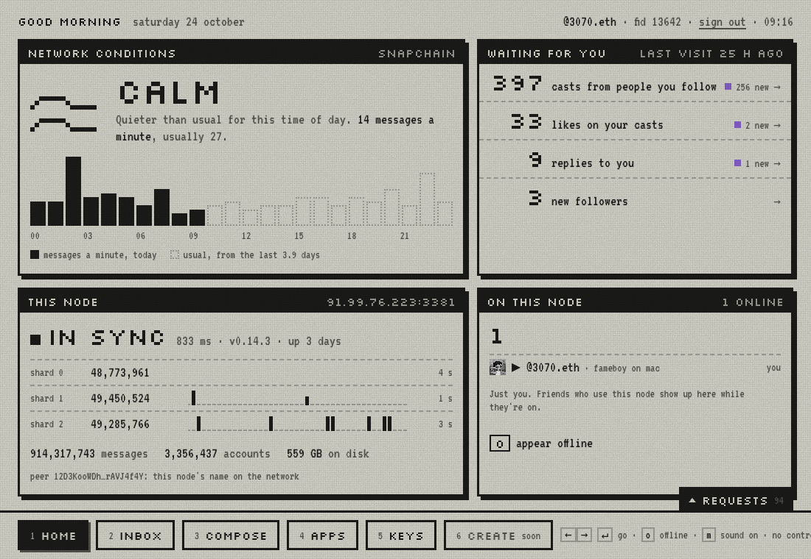

<p align="center">
  <a href="https://github.com/eucalyptus-viminalis/create-fc">
    <picture>
      <source media="(prefers-color-scheme: dark)" srcset="brand/logo/create-fc-lockup-white.svg">
      <source media="(prefers-color-scheme: light)" srcset="brand/logo/create-fc-lockup.svg">
      
    </picture>
  </a>
</p>

<p align="center">
  <b>Run your own Farcaster.</b><br>
  A Snapchain read node you control, and a small client that reads from it and posts through it.<br>
  Three commands. No API keys from anyone. You furnish the compute.
</p>

<p align="center">
  <a href="LICENSE"></a>
  <a href="https://github.com/eucalyptus-viminalis/create-fc/actions/workflows/pages.yml"></a>
  
  
</p>

<p align="center">
  <a href="https://createfc.org">Website</a> ·
  <a href="https://createfc.org/quickstart/">Quickstart</a> ·
  <a href="https://createfc.org/docs/">Docs</a> ·
  <a href="https://demo.createfc.org">Live demo</a> ·
  <a href="https://createfc.org/troubleshooting/">Troubleshooting</a>
</p>

<p align="center">
  
</p>

## Why

Most Farcaster apps read the network through someone else's servers, with someone else's API keys, rate limits and terms. create-fc gives you your own copy of the network instead: it rents a server in your Hetzner account, loads a full Snapchain node onto it, and installs **fameboy**, a client that talks to that node and nothing else. You see exactly which node calls are behind every screen, and your keys stay on your computer or in your browser.

- **Your node, your account.** The server, the volume and the bill are yours. Delete them with one command when you're done.
- **No API keys.** fameboy reads from and writes to your node directly.
- **Fast setup.** A streamed snapshot load peaks at 556 GB on disk instead of ~1.5 TB, and the node is readable in about 2 hours.
- **Keys stay with you.** Sign in by approving in the Farcaster app; your seed phrase never has to leave your phone.
- **Share it.** Host fameboy on your node so friends can use Farcaster in a browser, with no install.
- **Agent friendly.** [AGENTS.md](AGENTS.md) lets an AI agent run the setup for you, with guardrails around money and secrets.

## Contents

- [Requirements](#requirements)
- [Quickstart](#quickstart)
- [Try it without a node](#try-it-without-a-node)
- [Let your AI agent do it](#let-your-ai-agent-do-it)
- [Using fameboy](#using-fameboy)
- [Signing in](#signing-in)
- [Posting](#posting)
- [Hosting fameboy for others](#hosting-fameboy-for-others)
- [Seed phrases](#seed-phrases)
- [Stopping the bill](#stopping-the-bill)
- [Troubleshooting](#troubleshooting)
- [What's in here](#whats-in-here)
- [Contributing and support](#contributing-and-support)
- [License](#license)

## Requirements

| You need | Why | Get it |
| --- | --- | --- |
| A [Hetzner Cloud](https://console.hetzner.com) project and an API token with Read & Write access | The node runs on a server in your account | New accounts may need ID verification first |
| The [`hcloud` CLI](https://github.com/hetznercloud/cli), logged in | Command 0 uses it to create the server | `brew install hcloud`, then `hcloud context create fc-node` and paste the token |
| An SSH key | To reach the server | `ssh-keygen -t ed25519` if `~/.ssh/` has none |
| Node.js 22.18+ and git | fameboy runs TypeScript directly | [nodejs.org](https://nodejs.org) |
| About $0.16/hour | A cx43 server with a 1000 GB volume, about $105/month, billed until you delete it | See [docs/Costs.md](docs/Costs.md) |

## Quickstart

**0. Create a server.** Takes about 30 seconds.

```bash
curl -fsSL https://raw.githubusercontent.com/eucalyptus-viminalis/create-fc/main/provision/hetzner.sh | bash
```

It ends with a line like this. Note the IP:

```text
Server fc-node is up at 203.0.113.7 (cx43, 1000 GB volume, fsn1).
```

Hetzner sometimes sells out of cx43. The script then tries other locations, then cpx41 (~$0.20/hour), and tells you which it got.

**1. Set up the read node** on it, about a minute after the server boots. Use the IP from command 0:

```bash
ssh root@<ip> 'curl -fsSL https://raw.githubusercontent.com/eucalyptus-viminalis/create-fc/main/node/setup.sh | bash'
```

This returns in seconds and keeps working in the background: about 2 hours to load the snapshot, then about 4½ more to catch up (6 h 20 min in total on our last run). Check on it any time:

```bash
ssh root@<ip> fc-node status
```

While catching up it says how far behind it is and how long to go. When it's done:

```text
  shard 0: 1s behind
  shard 1: 1s behind
  shard 2: 0s behind
in sync. Run command 2 on your own computer.
```

**2. Install the client** on your computer, pointed at your node. This already works while the node is catching up; only the newest casts are missing until it's in sync.

```bash
curl -fsSL https://raw.githubusercontent.com/eucalyptus-viminalis/create-fc/main/client/install.sh | bash -s -- http://<ip>:3381
```

Then open it:

```bash
fameboy ui
```

It opens in your browser on a sign-in page. See [Signing in](#signing-in).

> [!WARNING]
> **There is no npm package.** `npm create fc` and `npx create-fc` run an unrelated package that someone else published in 2022. Use the commands above.

## Try it without a node

Open [demo.createfc.org](https://demo.createfc.org): @fameboyclear, the copy we host. Sign in by approving in the Farcaster app, or with your seed phrase; nothing to install.

The demo runs on a small server with no node of its own. It reads from and posts through [Hypersnap](https://hypersnap.org/)'s public node, which follows the same network as Farcaster's own ([ADR 007](docs/adr/007-hypersnap-public-node.md)).

Or install fameboy on your computer, pointed at our server, then run `fameboy ui`:

```bash
curl -fsSL https://raw.githubusercontent.com/eucalyptus-viminalis/create-fc/main/client/install.sh | bash -s -- http://91.99.76.223:3381
```

You can also point it straight at a public node, with no server of ours in between:

```bash
curl -fsSL https://raw.githubusercontent.com/eucalyptus-viminalis/create-fc/main/client/install.sh | bash -s -- https://haatz.quilibrium.com
```

A public node has no companion, so sign in with your seed phrase or your own app account (`fameboy app-account`). Image uploads and who's online need a companion, so they're off. Whoever runs a public node can see which accounts you look up.

## Let your AI agent do it

Paste this into an agent that can run commands on your computer (Claude Code, Codex and the like). It follows [AGENTS.md](AGENTS.md):

```text
Set up my own Farcaster read node and client with create-fc. Read https://raw.githubusercontent.com/eucalyptus-viminalis/create-fc/main/AGENTS.md and follow it step by step. Check with me before spending money or deleting anything. Never ask me for a seed phrase, private key or API token: when a step needs one, tell me the command to run in my own terminal.
```

Two steps stay with you: creating the Hetzner API token, and signing in if you want to post. Neither secret should go into a chat.

## Using fameboy

`fameboy ui` opens a home screen: your node's health, how busy the network is, what you missed since you last looked, and who else is on your node right now. Other tabs show your inbox, a composer, which apps your feed comes from (hide the big one in a click), and who can post as you. Every view shows the exact node calls behind it.

Prefer a terminal? A few common commands:

```bash
fameboy status                    # is the node in sync?
fameboy feed -n 20                # latest casts from everyone you follow
fameboy casts dwr -n 5            # someone's latest casts
fameboy feed --not-app <name>     # hide casts posted through one app
fameboy cast "hello from my own node"
fameboy update                    # update fameboy, keeping your sign-in and node
```

`fameboy --help` lists everything, including follows, likes, recasts, profiles and usernames.

## Signing in

fameboy shows your own feed, so it needs you signed in with an **app key**: a key that can post for your account but can't move it. The sign-in page offers two ways:

- **Approve in the Farcaster app** (recommended). Scan a QR code and approve on your phone; your seed phrase never leaves it. The request comes from an **app account**, the account people see as "@name wants to post on your behalf" and whose name their casts show "via". Set one up once:
  - **On your node, for everyone who uses it:** `ssh -t root@<ip> fc-node app-account`, then type that account's seed phrase there. Anyone can then sign in through your node. To keep it to friends, run `fc-node signin invite` and make a code per friend with `fc-node invite <name>`. The [share your node guide](https://createfc.org/docs/guide/share-your-node) covers what each choice puts at risk.
  - **On this computer only:** `fameboy app-account`, which saves that account's custody key here, so use an account made for this. If it has no username yet, setup suggests a free `@fameboy<color>` (e.g. `@fameboyteal`) and offers a display name, picture and bio so the approval screen looks like an app. Add `--sponsor` to pay the onchain fee for people signing in.
- **Use your seed phrase.** The same as `fameboy login` in a terminal. It stays on your computer.

No account yet? `fameboy new-account` registers one for about $0.20 of ETH on Optimism.

Signing out: `fameboy logout` deletes the app key from this computer. `fameboy revoke`, or **sign out** in the page, also revokes it on Farcaster first; the key signs its own removal, so no seed phrase is needed. Keys approved in the Farcaster app can also be removed there.

`fameboy profile --display … --pfp … --bio …` changes your profile; add `--app-account` to change the app account's instead.

## Posting

**post** in the home screen opens a composer with @-mentions from the people you follow, a byte counter (Farcaster counts bytes, and mentions are free) and up to two images.

Images upload to the node fameboy uses and are served from it over HTTPS (`https://<ip with dashes>.sslip.io/img/…`, via Caddy on ports 80 and 443). Each person gets 500 MB, each image up to 5 MB, and the node 10 GB in all; the node's owner can change that in `/var/lib/fc-companion/limits.json`. Images live as long as the server does. More in [Images in your casts](https://createfc.org/docs/guide/images).

## Hosting fameboy for others

Most people won't run a client. Once your node has an app account, this hosts fameboy at a web address, at no extra cost:

```bash
ssh root@<ip> fc-node client
```

It prints the address, `https://<app account's name>.<ip with dashes>.sslip.io` (or run `fc-node client <domain>` for your own domain). Anyone can open it, approve on their phone and use Farcaster through your node, unless you turn on invite codes with `fc-node signin invite`. `fc-node client off` stops it.

Each person's app key is made in their browser and never leaves it; every write is signed there, and the server keeps nothing about the people who use it ([ADR 003](docs/adr/003-hosted-clearcast.md)). Each copy is named after its app account ([ADR 004](docs/adr/004-naming-fameboy.md)). The [hosting guide](https://createfc.org/docs/guide/host-fameboy) covers addresses, who can sign in, and what people trust you with.

### Without a node of your own

Hosting fameboy doesn't need the node. A small server can run fameboy, the companion and image hosting, and read from a public node instead, for about $7.80 a month instead of $105. That's how [demo.createfc.org](https://demo.createfc.org) runs. Create the server:

```bash
curl -fsSL https://raw.githubusercontent.com/eucalyptus-viminalis/create-fc/main/provision/hetzner.sh | NO_NODE=1 bash
```

Then set it up against a public node, a minute after it boots:

```bash
ssh root@<ip> 'curl -fsSL https://raw.githubusercontent.com/eucalyptus-viminalis/create-fc/main/node/setup.sh | NODE=https://haatz.quilibrium.com bash'
```

Port 3381 on that server passes every request on to the public node, so fameboy installs pointed at `http://<ip>:3381` work as they would with a node there. Then set up `fc-node app-account` and `fc-node client` as above. The [hosting guide](https://createfc.org/docs/guide/host-fameboy#without-a-node-of-your-own) has the details.

## Seed phrases

A seed phrase controls the whole account, so treat it like `rm -rf`:

- Prefer **Approve in the Farcaster app**, so the phrase never leaves your phone.
- Only paste a seed phrase into software from developers you trust, after reading the code ([client/src/keys.ts](client/src/keys.ts)).
- Run `fameboy login`, `fameboy app-account`, `fameboy new-account` and `fc-node app-account` in your own terminal, never through an AI assistant's shell. Whatever they print ends up in the assistant's transcript.
- Creating an account? Pass `--recovery <address>` with an address you control.

## Stopping the bill

Delete the server, volume and firewall so nothing keeps billing. It lists what it will delete and asks you to type the server's name:

```bash
curl -fsSL https://raw.githubusercontent.com/eucalyptus-viminalis/create-fc/main/provision/hetzner-delete.sh | bash
```

Your app key in `~/.fameboy` survives. Next time, run commands 0 and 1 again (6–8 hours to sync), then re-run command 2 with the new IP.

Add `--keep-ip` (`… | bash -s -- --keep-ip`) to keep the server's address for a later server, for about $0.66 a month: give it to the new one with `PRIMARY_IPV4=<its id>` on command 0. DNS records, image links in casts, and installs pointed at that address then keep working.

## Troubleshooting

| You see | Do this |
| --- | --- |
| `fameboy: command not found` | Open a new terminal tab, or add `~/.local/bin` to your `PATH` |
| `REMOTE HOST IDENTIFICATION HAS CHANGED` | A new server reused an old IP. Run `ssh-keygen -R <ip>` and retry |
| `volumes size limit exceeded` | Your Hetzner account's volume cap is under 1000 GB. Check **Limits** in the Hetzner console ([why](https://createfc.org/docs/tutorial/server)) |
| `fc-node status` says setup stopped | Run command 1 again: it resumes where it left off |
| `npx create-fc` does something odd | That's someone else's package. See the warning in [Quickstart](#quickstart) |

More, from real runs: [createfc.org/troubleshooting](https://createfc.org/troubleshooting/).

## What's in here

| Path | What |
| --- | --- |
| [`provision/`](provision) | Command 0: Hetzner server, volume and firewall, and `hetzner-delete.sh` to remove them |
| [`node/`](node) | Command 1: Docker, the streamed snapshot load, the official `snapchain.sh`, and `fc-node` |
| [`client/`](client) | Command 2: `fameboy`, a browser client and CLI in TypeScript with no build step |
| [`docs/`](docs) | The docs at [createfc.org/docs](https://createfc.org/docs/): how each command works, guides, costs. Design decisions are in [`docs/adr/`](docs/adr) |
| [`brand/`](brand) | The create-fc logo and the script that draws it |
| [`AGENTS.md`](AGENTS.md) | Step-by-step instructions for an AI agent running the setup for you |

## Contributing and support

create-fc is early and actively developed. Expect things to change, and expect us to fix what breaks.

- **Bugs and ideas:** open a [GitHub issue](https://github.com/eucalyptus-viminalis/create-fc/issues). Pull requests are welcome; for anything big, open an issue first.
- **Working on the client:** `cd client && pnpm install && pnpm test`. `pnpm check` type-checks.
- **Working on the docs:** `pnpm install && pnpm docs:dev` at the repo root.
- **Questions:** message [@3070.eth](https://farcaster.xyz/3070.eth) on Farcaster.

**Help test it.** The first 5 people who run the three commands get $5 USDC to cover the server, whatever they think of it: claim it in Part IV of the [membership form](https://createfc.org/membership/) once your node is in sync. Want to do it together? Message [@3070.eth](https://farcaster.xyz/3070.eth) for a 30-minute session.

## License

create-fc is licensed under the [MIT License](LICENSE).
